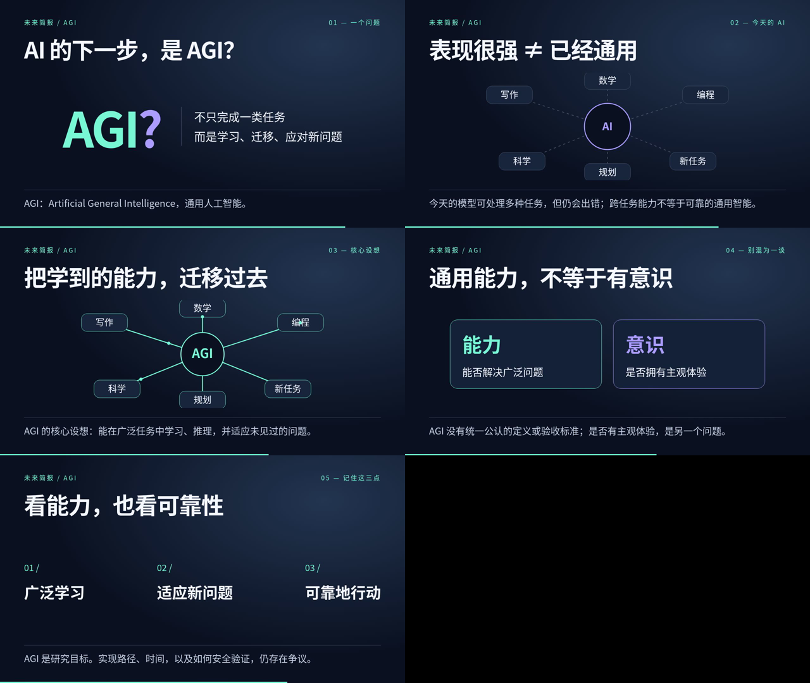

# AGI 是什么？

使用 Remotion 制作的中文科普动画，时长 40 秒，1280 × 720，30 fps。

这版采用屏幕文字和动态示意图，没有配音。

## 查看视频

打开 [AGI-explainer.mp4](./AGI-explainer.mp4)，点击 GitHub 文件页的下载按钮（Download raw file），下载后用浏览器或系统播放器打开。

[直接下载 MP4](https://github.com/12doraaa-netizen/test/raw/refs/heads/agi-video-20261012/videos/agi-explainer/AGI-explainer.mp4)

## 内容

1. 什么是 AGI
2. 今天的 AI 与通用智能的区别
3. 学习与能力迁移
4. 通用能力与意识是不同问题
5. 研究目标与仍存在的争议

## 画面预览

导出文件已通过完整解码检查：H.264、1200 帧、40 秒。
